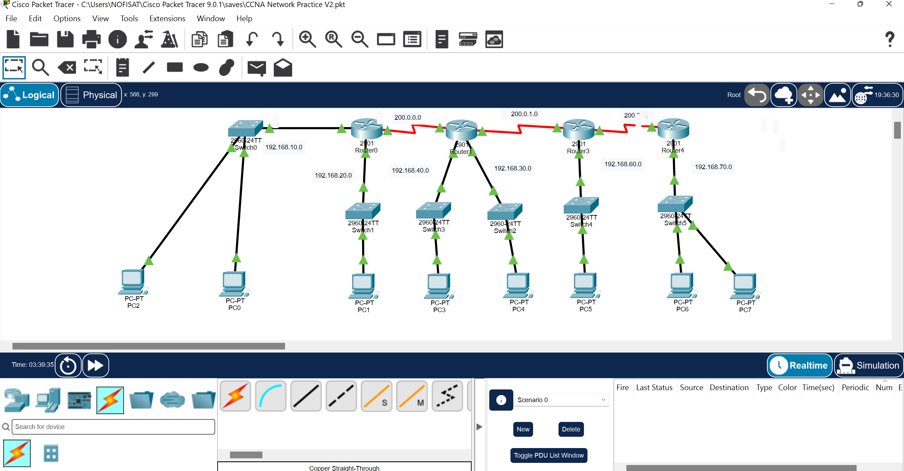

# VLAN Configuration and Inter-VLAN Routing Using Router-on-a-Stick

## 1. Objective

The objective of this practical was to configure Virtual Local Area Networks (VLANs), assign switch ports to their respective VLANs, configure trunking, and enable communication between different VLANs using Router-on-a-Stick.

## 2. Tools Used

- Cisco Packet Tracer
- Cisco Router and Switch
- PCs
- Cisco IOS CLI
  

## 3. VLAN Configuration

Two VLANs were created on Switch5:

| VLAN ID | VLAN Name |
|---|---|
| 10 | ADMINISTRATION |
| 20 | IT |

### Switch Port Assignment

| Switch Port | Connection | VLAN |
|---|---|---|
| Fa0/1 | Router4 G0/0 | Trunk |
| Fa0/2 | PC6 | VLAN 10 |
| Fa0/3 | PC7 | VLAN 20 |

## 4. IP Addressing

The original `192.168.70.0/24` network was divided into two `/25` subnets.

| Device | IP Address | Subnet Mask | Default Gateway |
|---|---|---|---|
| Router4 G0/0.10 | 192.168.70.1 | 255.255.255.128 | — |
| PC6 (VLAN 10) | 192.168.70.2 | 255.255.255.128 | 192.168.70.1 |
| Router4 G0/0.20 | 192.168.70.129 | 255.255.255.128 | — |
| PC7 (VLAN 20) | 192.168.70.130 | 255.255.255.128 | 192.168.70.129 |

## 5. Router-on-a-Stick Configuration

Router4 was configured with two subinterfaces:

- GigabitEthernet0/0.10 for VLAN 10
- GigabitEthernet0/0.20 for VLAN 20

802.1Q encapsulation was used to identify traffic belonging to each VLAN.

## 6. Static Routing

Static routes were updated on Router1 and Router3 to make both new `/25` networks reachable across the wider network.

**Router1:**
- 192.168.70.0/25 via 200.0.1.2
- 192.168.70.128/25 via 200.0.1.2

**Router3:**
- 192.168.70.0/25 via 200.0.2.2
- 192.168.70.128/25 via 200.0.2.2

## 7. Verification and Testing

The following connectivity tests were performed successfully:

| Test | Result |
|---|---|
| PC6 to VLAN 10 gateway | Successful |
| PC7 to VLAN 20 gateway | Successful |
| PC6 to PC7 (inter-VLAN) | Successful |
| PC6 to PC4 across routers | Successful |
| PC4 to PC7 across routers | Successful |

## 8. Troubleshooting

During configuration, an overlapping IP address error occurred when creating the VLAN 10 subinterface.

The issue was resolved by removing the existing IP address from the physical GigabitEthernet0/0 interface before configuring the subinterfaces.

A typing error in one of the static routes on Router3 was also identified and corrected.

## 9. Key Takeaways

This practical provided hands-on experience with:

- Creating and managing VLANs.
- Assigning access ports.
- Configuring trunk ports.
- Implementing Router-on-a-Stick.
- Configuring 802.1Q encapsulation.
- Subnetting a `/24` network into two `/25` networks.
- Updating static routes.
- Troubleshooting network configuration errors.

## 10. Project Files

The Cisco Packet Tracer simulation file and supporting screenshots will be included in this folder.
