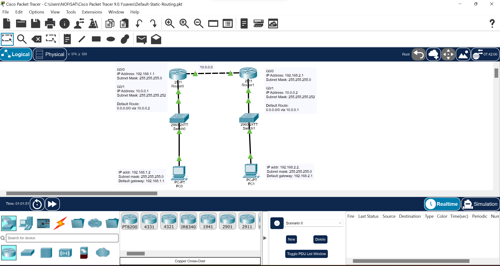

# Default Static Routing

## 1. Objective

The objective of this practical was to understand and configure default static routing in Cisco Packet Tracer, allowing two different LAN networks to communicate through two interconnected routers.

## 2. Tools Used

- Cisco Packet Tracer
- 2 Cisco 2911 Routers
- 2 Cisco 2960 Switches
- 2 End Devices (PCs)

## 3. Network Topology

The topology consists of two LANs connected through two routers.

- PC0 connects to Switch0, which connects to Router0.
- PC1 connects to Switch1, which connects to Router1.
- Router0 and Router1 are connected through their GigabitEthernet interfaces.

## 4. IP Addressing Scheme

| Device | Interface | IP Address | Subnet Mask |
|---|---|---|---|
| PC0 | FastEthernet0 | 192.168.1.2 | 255.255.255.0 |
| Router0 | G0/0 | 192.168.1.1 | 255.255.255.0 |
| Router0 | G0/1 | 10.0.0.1 | 255.255.255.252 |
| Router1 | G0/0 | 192.168.2.1 | 255.255.255.0 |
| Router1 | G0/1 | 10.0.0.2 | 255.255.255.252 |
| PC1 | FastEthernet0 | 192.168.2.2 | 255.255.255.0 |

### Default Gateways

- PC0: 192.168.1.1
- PC1: 192.168.2.1

### Router-to-Router Network

- Network address: 10.0.0.0/30
- Router0: 10.0.0.1
- Router1: 10.0.0.2
- Broadcast address: 10.0.0.3
- Subnet mask: 255.255.255.252

## 5. Router Configuration

### Router0 Configuration

```text
enable
configure terminal
interface gigabitEthernet 0/0
ip address 192.168.1.1 255.255.255.0
no shutdown
exit

interface gigabitEthernet 0/1
ip address 10.0.0.1 255.255.255.252
no shutdown
exit

ip route 0.0.0.0 0.0.0.0 10.0.0.2
```

### Router1 Configuration

```text
enable
configure terminal
interface gigabitEthernet 0/0
ip address 192.168.2.1 255.255.255.0
no shutdown
exit

interface gigabitEthernet 0/1
ip address 10.0.0.2 255.255.255.252
no shutdown
exit

ip route 0.0.0.0 0.0.0.0 10.0.0.1
```

## 6. Default Routing Explanation

A default route is used when a router does not have a more specific route to a destination network in its routing table.

The command used to configure a default route is:

```text
ip route 0.0.0.0 0.0.0.0 NEXT-HOP-IP
```

In this practical:

- Router0 forwards unknown traffic to Router1 using 10.0.0.2.
- Router1 forwards unknown traffic to Router0 using 10.0.0.1.

Both routers require default routes to allow communication in both directions.

## 7. Verification

The following commands were used to verify the configuration:

**Check interface status**

```text
show ip interface brief
```

Both routers' configured interfaces were verified as up/up.

**Check routing table**

```text
show ip route
```

The default route appeared as:

Router0:
```text
S* 0.0.0.0/0 via 10.0.0.2
```

Router1:
```text
S* 0.0.0.0/0 via 10.0.0.1
```

**Test router-to-router connectivity**

```text
ping 10.0.0.2
```

The initial test returned 80% success. A subsequent test returned 100% success.

**Test end-to-end connectivity**

From PC0:

```text
ping 192.168.2.2
```

Result:
- Packets sent: 4
- Packets received: 4
- Packets lost: 0
- Success rate: 100%

This confirmed successful communication between the two LANs.

## 8. Troubleshooting and Observations

Before configuring the default routes, PC0 could not reach PC1. Router0 returned a destination host unreachable message because it did not have a route to the remote LAN.

After configuring default routes on both routers, communication became successful.

The initial router-to-router ping experienced one timeout, but the subsequent test achieved 100% success.

## 9. Key Learning Outcomes

Through this practical, I gained experience in:

- Assigning IPv4 addresses and subnet masks to router interfaces and PCs.
- Understanding the purpose of a /30 subnet for a point-to-point router connection.
- Configuring and activating router interfaces.
- Understanding next-hop addresses.
- Configuring default static routes.
- Reading and interpreting routing tables.
- Verifying connectivity using ping.
- Understanding how routers forward traffic when a specific route is unavailable.

## 10. Project File

The Cisco Packet Tracer project file is included in this folder for download and practical review.

**File:** `Default-Static-Routing.pkt`

